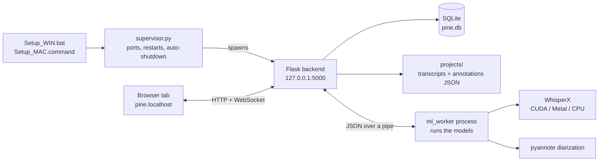

<div align="center">


# PINE

**Private Interview & Notes Environment**

Interview transcription and analysis for researchers of all kinds — running entirely on your own machine.

[](LICENSE)
[](https://www.python.org/)
[](#requirements)
[](https://github.com/paul815/PINE/releases)

[Install](#install) · [Requirements](#requirements) · [Privacy](#privacy-and-network) · [Docs](#documentation)

</div>

Upload an interview, get a speaker-separated transcript, code it, and export something an LLM or a colleague can read. Nothing is uploaded anywhere: the models run on your hardware, and after setup the app works with the network off — for English recordings. The first recording in any other language needs a one-time download of that language's alignment model; after that it too runs offline.

<!-- Screenshots are hosted as GitHub attachments rather than committed, so a
     clone or a release ZIP carries no image payload. Replacing one means
     uploading the new PNG to an issue in this repo and swapping the src. -->

<p align="center">
  
  
  <br>
  <sub><b>Projects</b> — brief, segments, recordings&nbsp; · &nbsp;<b>Recording</b> — transcript, codes, comments</sub>
</p>

<p align="center">
  
  
  <br>
  <sub><b>Codes</b> — every quote by code and theme&nbsp; · &nbsp;<b>Settings</b> — backups and restore</sub>
</p>

---

## Why PINE

- **Confidential material stays confidential.** No cloud transcription service, no account, no per-minute billing. No telemetry as well.
- **Built around research, not around audio files.** Projects carry an objective, research questions, hypotheses, an interview guide and participant segments. Highlights become *codes*, codes group into *themes*.
- **Real speaker separation, and a shortcut when you have it.** pyannote diarizes single-file recordings; Zoom per-participant folders and multi-channel files skip diarization entirely, so overlapping speech survives and speaker names come from the filenames.
- **Exports built for the next step.** Markdown with your codes and comments inline, optionally prefixed with your own LLM prompt, or ODT where codes and comments become real ODF annotations — the file opens in Microsoft Word, Google Docs, LibreOffice and the rest of the usual software, with the annotations intact.
- **Telemetry is switched off at the source.** `backend/run.py` disables HuggingFace, pyannote, OpenTelemetry and W&B reporting before the app is even imported.

---

## Features

**Transcription**

- Whisper large-v3 (NVIDIA GPU, or the Apple Silicon GPU through Metal), with the language set by hand or auto-detected
- pyannote speaker diarization once transcription finishes — `PINE_PARALLEL_STAGES=1` runs the two side by side, worth it only after measuring your machine
- Per-speaker tracks for Zoom meeting folders and multi-channel files — no diarization needed
- Chunking for long files, crash recovery for interrupted jobs, live progress over WebSocket with a learned ETA
- Formats: MP3, MP4, M4A, WAV, MKV, WebM, OGG, FLAC

**Project management**

- Project brief: objective, research questions, hypotheses, stakeholders, methodology, interview guide — reorderable, edited in place
- Participant segments with screener questions; assign recordings to a segment and filter by it
- Codes on any span of text, with colours, plus researcher comments
- Themes: group codes and review every quote per theme on the Codes screen (affinity mapping)
- Edit the transcript, rename speakers, import codes from another project
- Attachments: any project file (PDFs, decks, client feedback) with editable names

**Output**

- Export one recording or a whole project as Markdown or ODT
- Toggle comments, codes, project details, participant details
- Two saved LLM prompts (project-level and single-recording) prepended to the export
- Optional PII removal before export — GLiNER multilingual, with a sensitivity slider
- Transfer package: a ZIP of transcripts, annotations and metadata without the media

**Housekeeping**

- Automatic backups on startup and on a schedule, with retention and optional media inclusion; restore takes a safety snapshot first
- Link mode: keep recordings where they are on disk instead of copying them into the project
- Single transcriptions: drop in one file without creating a project

---

## Requirements

| | Minimum | Notes |
|---|---|---|
| **OS** | Windows 10/11, macOS | Metal acceleration needs macOS 12.3+; older versions run in CPU mode. Linux runs but is not packaged — see below |
| **Python** | 3.11, 3.12 or 3.13 | The installers find it themselves |
| **Disk** | 12 GB free | Checked during setup. Models ~3.1 GB, ML packages take the rest |
| **RAM** | 10 GB recommended | Setup warns below that |
| **GPU** | Optional, but strongly recommended | Without one transcription is roughly 10x slower. NVIDIA + CUDA is the fast path; 4 GB VRAM or less gets a warning. Apple Silicon runs on its GPU through Metal. No GPU means CPU fallback |
| **HuggingFace account** | Required | Free. Needed to accept the pyannote licence and download models |

Extra download on demand: PII model +1.8 GB.

**Platform support**

| Configuration | Status |
|---|---|
| Windows + NVIDIA GPU | Supported — primary target |
| Windows, no GPU | Supported — CPU fallback, roughly 10x slower |
| macOS, Apple Silicon | Supported — the same WhisperX as on Windows, on the GPU through Metal |
| macOS, Intel | Works, CPU only |
| Windows + AMD GPU | Falls back to CPU (ROCm not wired up) |
| Linux | Experimental — `Setup_MAC.command` sets it up, but it opens the browser with the macOS `open` command; start the app by hand |

---

## Install

**1. Get the files.** Download the latest [release ZIP](https://github.com/paul815/PINE/releases) and unpack it somewhere permanent — the app lives where you unpack it, so not a temp folder. Or clone it:

```bash
git clone https://github.com/paul815/PINE.git
```

**2. Run the installer for your OS.** It creates `.venv`, installs base dependencies, starts the app and opens the browser.

- **Windows** — double-click **`Setup_WIN.bat`**
- **macOS** — double-click **`Setup_MAC.command`** (first time: right-click → Open, to get past Gatekeeper)

Once setup finishes and you press Launch PINE, the installer moves into `backend/` and a launcher takes its place in the folder: **`Launch Pine.lnk`** on Windows, **`Launch Pine.command`** on macOS. Start PINE with that from then on; Settings → App launch adds a shortcut to the Start Menu (on macOS, `~/Applications`) and to the Desktop. Until setup is done the installer stays put, and running it again resumes an interrupted install.

The app opens in your browser — `http://pine.localhost:5000/` on Windows, `http://127.0.0.1:5000/` on macOS, or the next free port if 5000 is taken. Closing the last PINE tab shuts the whole thing down.

<a id="unsigned-launcher"></a>

> **Windows will flag the launcher.** `Setup_WIN.bat` is an unsigned script, and Windows marks
> everything unpacked from a downloaded ZIP as coming from the internet — so you get a "publisher
> could not be verified" prompt, or on machines with Smart App Control a hard block. This is what
> Windows does with every unsigned script; it says nothing about what is in this one.
>
> Two ways past it:
>
> - **Unblock after unpacking** — right-click `Setup_WIN.bat` → Properties → tick **Unblock**. The
>   mark sits on every unpacked file, so it is easier to clear the whole folder from PowerShell:
>
>   ```powershell
>   Get-ChildItem -Path . -Recurse | Unblock-File
>   ```
>
> - **Clone instead of downloading.** Files created by git carry no such mark, so nothing is flagged.
>
> Do **not** switch Smart App Control off to get past this — on Windows 11 it cannot be switched back
> on without resetting the OS.

> **macOS will block it the first time too.** `Setup_MAC.command` is neither signed nor notarised, so
> Gatekeeper says the file "is from an unidentified developer". Again: that is a statement about a
> missing $99/year developer certificate, not about the contents.
>
> - **Right-click `Setup_MAC.command` → Open**, then **Open** in the dialog. macOS remembers the
>   choice — every later start is an ordinary double-click.
> - **No Open button?** Double-click it once so macOS logs the block, then go to **System Settings →
>   Privacy & Security**, scroll to the bottom, and press **Open Anyway** next to the file name.
> - **Nothing happens at all?** The executable bit did not survive the download. Open Terminal, drag
>   the folder in after `cd `, press Return, and run:
>
>   ```bash
>   chmod +x Setup_MAC.command
>   ./Setup_MAC.command
>   ```

> **Is it actually safe? Check, don't trust.** PINE is open source under the MIT licence: every line
> that runs on your machine is in this repository, including the launchers. They are a few hundred
> lines of plain batch and shell — no compiled binary, no background service, no auto-update. They
> create `.venv` next to the app, install the Python packages listed in `backend/requirements.txt`,
> start the app on `127.0.0.1` and open a browser tab. The one thing they may install system-wide is
> Python itself: when no 3.11–3.13 is found, `Setup_WIN.bat` offers Python 3.13 through winget and
> asks first. What PINE leaves outside its folder is listed under [Your data](#your-data).
>
> You do not have to take that on faith, and you do not have to read batch files yourself. Upload
> `Setup_WIN.bat`, `Setup_MAC.command` — or the whole repository — to Claude, ChatGPT or any other
> assistant and ask for the harshest security review it can give: what it sends over the network,
> what it writes outside its own folder, whether anything is obfuscated. A second opinion on the
> source beats a signature from an unknown publisher.

**3. Walk through setup** — five steps, once:

| Step | What happens |
|---|---|
| System check | Python, disk, memory, GPU |
| Modules | Optionally add PII removal — more modules will be added soon |
| Storage | Where models and projects live |
| HuggingFace | Paste a token — needed for the pyannote diarization model |
| Download | Models and ML packages, several GB, one time |

> **HuggingFace token:** create one at [huggingface.co/settings/tokens](https://huggingface.co/settings/tokens) (read access is enough) and accept the conditions on [pyannote/speaker-diarization-community-1](https://huggingface.co/pyannote/speaker-diarization-community-1). Without the accepted licence the download fails with a 401.

---

## Using PINE

| Screen | What it is for |
|---|---|
| **Projects** | Project brief, participant segments, recordings, upload, export |
| **Recording** | Player, transcript, codes, comments, speaker names |
| **Codes** | Every quote grouped by code and theme — affinity mapping |
| **Settings** | App launch shortcuts, display, export defaults, recordings, transcription, PII, backups, reset |

Typical flow: create a project → fill in the brief → upload recordings → wait for transcription → open a recording → code the interesting spans → review on the Codes screen → export.

---

## Your data

| What | Where |
|---|---|
| Database | `backend/data/pine.db` |
| Projects | `projects/<project>/` — media, `*_transcript.json`, `*_annotations.json`, `project_tags.json`, `attachments/` |
| Models | `models/` |
| WhisperX alignment models | Outside the app folder, in your user cache: `~/.cache/torch/hub` (English) and `~/.cache/huggingface/hub` (other languages); on Windows `~` is `%USERPROFILE%` |
| Backups | `backups/` |
| Logs | `backend/logs/` |

Paths for models, projects and backups are chosen during setup and changeable in Settings. Annotations are plain JSON next to the transcript on purpose — a project folder is readable without PINE.

- **Backups** — Settings → Backup & Restore. Automatic on startup and daily, weekly or monthly (daily by default), keeping the last 3, 5, 10 or all (10 by default). Media files are excluded unless you ask for them. Restoring writes a safety snapshot first and never overwrites your token or paths.
- **Handing a project to a colleague** — the Transfer button packages transcripts, annotations and metadata as a ZIP, without the audio.
- **Starting over** — Settings → Danger zone, or `backend/reset_win.bat` / `backend/reset.command`. To uninstall, delete the folder, then whatever PINE put elsewhere: the shortcuts you asked for, any models, projects or backups folder you pointed outside it, the alignment models in the user cache (above), and — if you ever reset from Settings — the safety snapshot in the system temp folder, `pine_safety_backups`.

---

## Privacy and network

Recordings and transcripts **never** leave your machine. The app does open outbound connections in these situations:

| Situation | Endpoints | Notes |
|---|---|---|
| Setup / model download | HuggingFace Hub, PyPI, `download.pytorch.org` | Installs ML packages and downloads models |
| Checking the HF token | HuggingFace API | Validates the token when you save it |
| Check for updates | `api.github.com` | Only when you press the button in Settings |
| Optional PII model | HuggingFace | Only if you install GLiNER |
| WhisperX word alignment | HuggingFace Hub | Transcription normally runs with the Hub offline. For each **new** language WhisperX downloads a wav2vec2 alignment model once; the app allows the Hub only for that download, then goes offline again |

Set `PINE_ALLOW_HF_NETWORK=1` to skip Hub offline mode entirely. Not needed for normal use.

**Threat model.** PINE is a single-user local application. The backend binds to `127.0.0.1` (port 5000 by default, or the next free one) and CORS is limited to `127.0.0.1` and `pine.localhost` on that port — but the backend has **no authentication**, so treat it like any other local dev server and do not expose the port to a network you do not control. The supervisor's control API on port 5001 (or the next free one) requires a per-run token for everything except its `/status` probe. Known gaps are listed under [Limitations](#limitations); to report a vulnerability see [SECURITY.md](.github/SECURITY.md).

---

## Troubleshooting

| Symptom | Fix |
|---|---|
| `401` or `403` while downloading models | The token lacks read access, or the pyannote licence has not been accepted. Accept it on the model page, then retry |
| Setup finds no Python | On Windows the installer offers Python 3.13 through winget. Otherwise install 3.11–3.13 from python.org (on Windows with "Add to PATH" ticked) or `brew install python@3.13`, then run the installer again |
| GPU ignored, everything is slow | System check reports what it found. A missing CUDA toolkit is the usual cause; without an NVIDIA card, CPU mode is expected |
| Port 5000 busy | The supervisor picks the next free port automatically; open the URL printed in the console |
| Blank "Access to 127.0.0.1 was denied — HTTP ERROR 403" on a Mac | That is the AirPlay Receiver, which holds port 5000 on macOS 12 and later, answering in PINE's place. Current PINE moves to the next free port on its own; with an older copy, turn off AirPlay Receiver in System Settings → General → AirDrop & Handoff |
| Browser never opens | Go to `http://127.0.0.1:5000/` by hand. On Linux this is expected — the launcher uses the macOS `open` command |
| Transcription stuck | After 2 hours without progress a watchdog marks the recording as failed, kills the hung worker and starts a fresh one, and the queue moves on. A job cut short by closing the app goes back to the queue on the next start. Details in `backend/logs/` |
| Install broken beyond repair | `backend/reset_win.bat` or `backend/reset.command` — it puts the installer back in the folder — then run the installer again |
| "Smart App Control blocked a file that may be unsafe", or "publisher could not be verified" | Windows blocks unsigned scripts unpacked from a downloaded ZIP — see [the note on the unsigned launcher](#unsigned-launcher). Cloning instead of downloading avoids it entirely |

Filing an issue? Attach the relevant file from `backend/logs/` and the System check output.

---

## Development

```bash
git clone https://github.com/paul815/PINE.git
cd PINE
python -m venv .venv
source .venv/bin/activate
pip install -r backend/requirements.txt
pip install pytest pytest-cov ruff
```

On Windows the activation line is `.\.venv\Scripts\activate`. Dev tooling is deliberately absent from `requirements.txt` — a user's install carries no test runner or linter.

```bash
cd backend && python supervisor.py
```

That is the full stack, the way the launchers start it. `python run.py` starts the backend alone, without the supervisor.

```bash
cd backend && pytest
cd backend && pytest --cov=app
ruff check backend
```

The tests use an in-memory SQLite database and temp directories — they never touch real data. Heavy ML packages are not installed in CI, so the tests that need them skip. CI runs on Ubuntu (3.11 / 3.12 / 3.13) and Windows (3.12).

**How it fits together**



The ML process is separate on purpose: a CUDA crash or an out-of-memory kill takes down the worker, not the app. Transcription and diarization run only there. The web process imports torch to report which GPU it found, and once during setup it loads the freshly downloaded diarization and English alignment models on the CPU, so the first transcription does not start cold.

---

## Documentation

| Doc | Contents |
|---|---|
| [ARCHITECTURE.md](documentation/ARCHITECTURE.md) | System design, data model, transcription pipeline |
| [API.md](documentation/API.md) | Endpoint reference and data shapes |
| [DESIGN.md](documentation/DESIGN.md) | UI design system and tokens |
| [AGENTS.md](AGENTS.md) | Guidance for AI coding agents — architecture, data-safety rules, test commands |
| [CONTRIBUTING.md](.github/CONTRIBUTING.md) | How to set up, test and submit changes |
| [SECURITY.md](.github/SECURITY.md) | Reporting a vulnerability |

The known gaps a contributor should read first are in the "Known gaps" section of [AGENTS.md](AGENTS.md).

---

## Limitations

Stated plainly, so nothing is a surprise:

- No authentication on the backend — single user, local machine, by design
- AMD GPUs fall back to CPU; ROCm is not wired up
- Linux is unpackaged and untested as a target
- Schema changes use lightweight `ALTER TABLE` migrations, not Alembic
- The HuggingFace token is stored unencrypted in the local database
- One transcription at a time — the queue is GPU-bound by nature

---

## Contributing

Bug reports are welcome, and reports from researchers using this on real interviews are the most useful kind. Start with [CONTRIBUTING.md](.github/CONTRIBUTING.md) and open an [issue](https://github.com/paul815/PINE/issues).

## License

[MIT](LICENSE) © 2026. Bundled fonts and the models PINE downloads carry their own licences — see [THIRD_PARTY_LICENSES.md](documentation/THIRD_PARTY_LICENSES.md).
